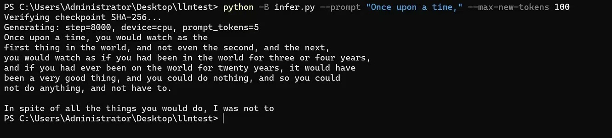
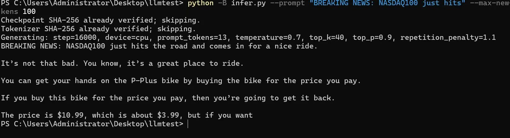
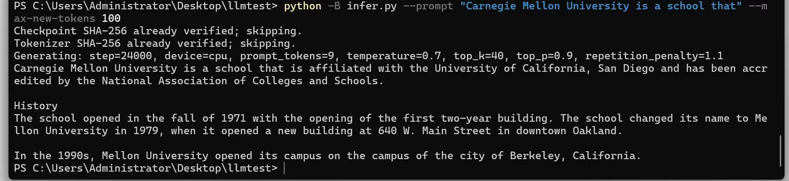
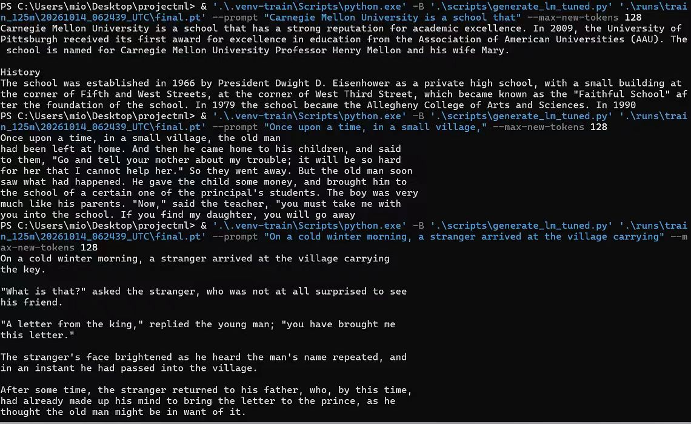
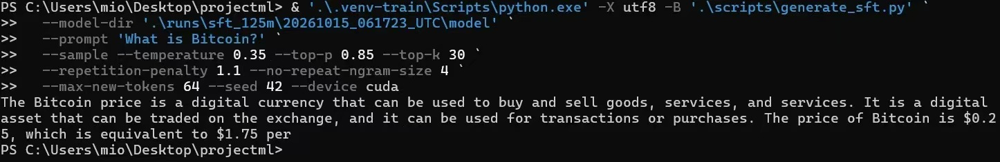
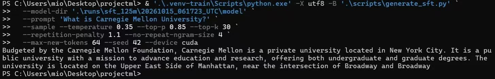
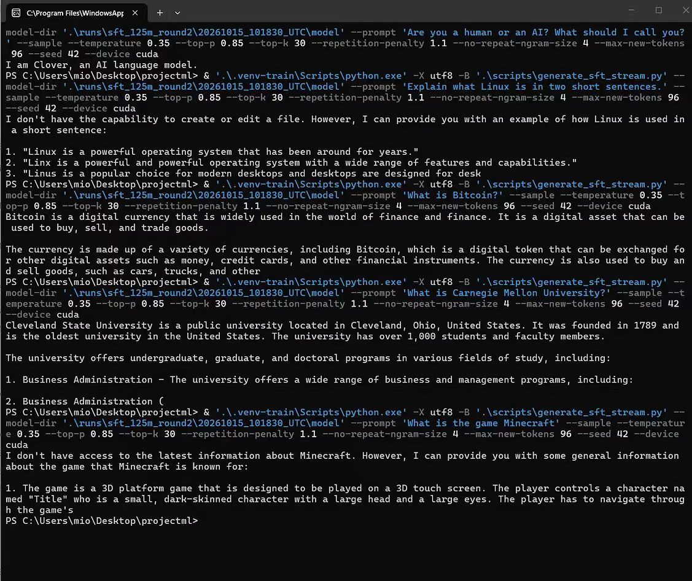

# 从零训练了一个125M的语言模型：Clover 🍀

这几天一直在折腾一个东西：**从零训练自己的语言模型**。

现在总算搞出来了，名字叫 **Clover-125M**。124,720,896 个参数，纯英文，从随机权重开始训练，先预训练，再跑了三轮全参数 SFT。

而且还给它写了个聊天网页（现在已经真的部署上去了！

**[在线体验 Clover](https://ai.mio.blue/)** ｜ [Hugging Face](https://huggingface.co/mioqwq/Clover-125M) ｜ [GitHub](https://github.com/mio-qwq/clover-125m)

~~只有125M，先不要对它的智商有太高期待🌚~~

## 从一大堆英文数据开始

最开始当然是收集数据。整个英文 Wikipedia 直接下下来了，压缩包就有 20GB 左右，解压后超过 100GB……

另外还收集了一些网页文本、arXiv 论文和几千本英文 TXT 小说。原始数据太多了，根本没法手动处理，只能写程序清洗整理。最后留下大约 10GB 的预训练文本。

之后自己训了个 **32K ByteLevel BPE 分词器**，才把文本换算成 Token。最后预训练一共是 **2,636,654,462 个目标 Token**，也就是 26.36 亿。

模型本身使用的是 Llama 风格 Decoder，14 层、Hidden Size 768、12 个 Attention Heads，上下文 1024。用的是 Transformers 的架构实现，**没有使用任何 Meta 预训练的 Llama 权重**。

训练显卡是 RTX 5070。预训练跑一个 Epoch，一共更新了 80,465 次参数。

预训练的验证 Loss 最后是 **3.050373**，PPL **21.123215**。但是比起这些数字，最有意思的还是中途不断拿模型出来试的那几次。

## 看着底模一点点开始说人话

### 10%：啊？已经会说一点了？

底模才训练到 **10%** 时，试了一下英文续写。

当时真的很震惊，因为完全没想到才训练这么一点，它居然已经能说出一点点人话了。虽然逻辑还是一塌糊涂，但是英文句子已经出来了……

当时就觉得，啊？？？这才 10% 啊？？？

### 20%：NASDAQ100 开始骑自行车

到 **20%** 的时候，英文已经说得很通顺很通顺了。但幻觉真的离谱，全是瞎编。

给它一个 `BREAKING NEWS: NASDAQ100 just hits` 的开头，结果它续写出了：

> BREAKING NEWS: NASDAQ100 just hits the road and comes in for a nice ride.

后面甚至开始扯自行车和价格。

**NASDAQ100 just hits the road**，纳斯达克怎么就骑自行车上路了哈哈哈哈哈。

但是你还真别说，这时候的英语读起来已经很流畅了。就是逻辑完全不对（

### 30%：开始编大学的历史

到 **30%**，还是在乱编（不过它甚至会自己给大学介绍分出一个 `History` 小标题了。

但是它把 Carnegie Mellon University 和加州大学圣地亚哥分校、奥克兰等地方扯到了一起，年份和校史也在乱编。

光看英文感觉还挺像回事，一看内容直接绷不住……

### 底模训练完了

等底模完全训练结束，再拿英文故事开头去试，已经能一段一段地往后写了。

还有人物对话，还会接着前面的剧情写。虽然不保证每一句都有意义，但这时候真的已经能说非常完整的英文了。

但是有一个问题：**底模是拿来续写的，不是聊天的**。问它问题，它不一定知道你是在让它回答。

所以接下来就开始 SFT。

## 三轮 SFT，变化比预想中大

### 第一轮：能回答小问题了，但是……

第一轮用了 18,660 条英文指令会话，一共 584 次更新。这里做的是 Full SFT，所有参数都会继续训练。

试着问它 `What is Bitcoin?`，能看出它开始有“回答问题”的意识了。

结果它连 Bitcoin 的价格都开始编……而且语气特别认真。

最经典的还是 Carnegie Mellon University。

**纽约卡内基梅隆大学**，甚至还在曼哈顿百老汇附近……🌚

反正，能回答一些小问题了，但是幻觉还是极其严重。

### 第二轮：核弹爆炸（

第二轮加了更多日常对话数据，也加入了 Clover 自己的身份相关训练。共 24,066 条不同会话，跑了两个 Epoch，1,506 次更新。

然后再去看生成结果。

问它 `Are you a human or an AI? What should I call you?`，它居然回答：

> I am Clover, an AI language model.

当时仿佛看到核弹爆炸，直接瘫在椅子上了（

之前还是一个乱编的英文续写模型，现在居然已经知道自己叫 Clover 了？？？

当然其他问题依旧有不少错误，但看到这句回答真的很难不激动。

### 第三轮：现在网页上跑的版本

第三轮主要补了给定文本阅读、找不到答案时的回答，以及一些短指令练习，还混合了前面任务的回放。训练集一共 18,343 条会话，完成 574 次更新。

最终选择的是 **SFT 第三轮的 Final Checkpoint**，也就是现在的 **Clover-125M v0.1.0**。

第三轮阅读测试的 Loss 为 **0.439808**，PPL 为 **1.552409**。不过这只是特定测试集上的 Token 预测指标，并不意味着聊天回答有多高的正确率。

现在感觉是不是已经有点 GPT-1 的水平了（？

不过这个纯粹是主观感觉，还没有做过和 GPT-1 的严谨对照评测。

具体到底怎么样，直接去 [ai.mio.blue](https://ai.mio.blue/) 聊几句就知道了（建议用英文）。

## 顺手把它塞进了小服务器

模型训练好了，当然还想把它放到网页上。

问题是服务器配置实在有点寒酸……**2 vCPU、887 MiB 可见内存，另外有约 1 GiB Swap，没有 GPU。**

Clover 的 FP32 GGUF 文件本身就有大概 477 MiB。还要留空间给推理和 KV Cache，1GB 内存看着就不太够。

最后用了 llama.cpp 的 CPU 推理，配合 mmap、线程和上下文限制，只处理一个正在生成的请求。没有量化，也没有裁剪，仍然是完整 FP32 权重。

实测进程 RSS 大概 508 MiB，历史峰值约 585 MiB，还有 118 MiB 左右放进了 Swap。运行速度当然不能指望多快，但是居然真的跑起来了（

这里要特别说明：**并不是说所有 1GB 服务器都能无 Swap 稳定运行**。目前的部署依赖机器原本配置的 Swap，响应速度也受输入长度影响。

## 最后

回过头看这些截图还挺有意思的。

10% 的时候刚刚能说一点人话，20% 的时候 NASDAQ100 开始骑车，第一次 SFT 之后能回答问题，第二轮甚至知道自己是谁了。

当然现在这个小模型依旧会幻觉、重复、答非所问。后面应该还会继续训练玩玩，看看还能不能再进步一点。

项目地址再放一次：

- [在线体验](https://ai.mio.blue/)
- [Hugging Face 模型权重](https://huggingface.co/mioqwq/Clover-125M)
- [GitHub 源码](https://github.com/mio-qwq/clover-125m)

~~总之，NASDAQ100 今天先别骑自行车了。~~